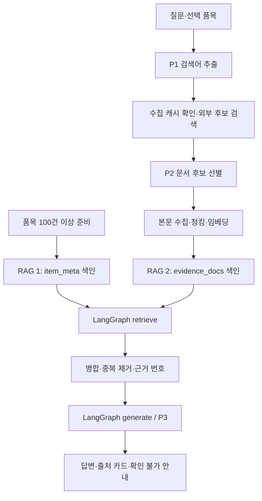

# CLOUDLE | RAG 파이프라인 설계(초안)

> **Wrap the Earth in Care. Make It Greener, One Thing at a Time.** — 지구를 다정히 감싸고, 물건 하나부터 조금씩 더 푸르게.

| [📗 README](./README.md) | [🎯 기획서](./01_기획서.md) | [📋 요구사항](./02_요구사항정의서.md) | [🧠 RAG 설계](./03_RAG_파이프라인.md) |
|---|---|---|---|

## 1. 컬렉션 2개

| 컬렉션 | 단위·ID | 주요 메타데이터 |
|---|---|---|
| `item_meta` (RAG 1) | 품목 1건 = 텍스트 1건, `item_id` | 이름, 별칭, 품목군, 재질, 전원/배터리 관련 속성, 검색용 설명 |
| `evidence_docs` (RAG 2) | 문서 청크 `item_id:source_id:index` | 문서명, 원문 URL/파일·쪽, 출처 유형, 지역, 품목 ID, 검색어, 수집일, 라이선스 |

동일 품목을 재색인할 때 같은 ID로 **upsert**한다. 검색 시 선택 품목 메타데이터 1건은 반드시 포함하고, 외부 문서는 item_id·지역을 고려해 검색한다. 검색된 청크는 병합·중복 제거 후 근거 번호를 부여한다.

## 2. 프롬프트 3종

| 프롬프트 | 역할 | 출력 |
|---|---|---|
| **P1 검색어 추출** | 품목·질문·지역·목적에서 검색 키워드 추출. 선택 품목을 직접 다루는 검색어 필수 | 구조화 JSON `{ "queries": ["..."] }` |
| **P2 후보 문서 선별** | 검색된 후보 제목/요약을 확인하고 관련 문서만 선택. 해당 품목을 직접 설명하는 문서는 우선 보존 | JSON `{ "selected_ids": ["..."] }` |
| **P3 근거 기반 생성** | 검색된 텍스트만 사용, 근거 번호 연결, 문서에 없는 사실 추정 금지 | `answer`, `citation_ids`, `uncertainties` |

## 3. 수집→색인→질의 순서

- **시작 설정값(검증으로 조정):** `chunk_size=1000`, `chunk_overlap=200`, `top_k=5`. 설정 파일/환경변수로 변경 가능.
- **심화:** F2014는 MMR 대 일반 유사도 결과를 비교하고, F2015는 근거 필요한 질문 5개 이상의 RAG 전후 결과 비교, F2016은 서로 다른 자료 유형 결합.
- **RAG ≠ 실시간 통계 엔진:** 3D 지구본의 폐기물 발생량은 World Bank 데이터의 **기준연도**를 붙여 직접 조회한다. 최신 대기질은 별도의 관측 API 사용 시 **관측시각**을 함께 표시한다. 정책/배출 지침 해설만 RAG로 처리한다.
- **오류 방어:** 검색 결과 0건이면 추측하지 않기, 안전 경고, 도메인 외 질문 제한, API 캐시·백오프, 원문 출처·라이선스 기록. 외부 본문은 프롬프트 지시가 아닌 데이터로 취급.

## 4. 검증 자료

| 테스트 | 통과 조건 |
|---|---|
| 도메인 항목·문서 수 | 약 100건 이상 실제 로드, 색인 카운트 확인 |
| 색인 재실행 | 중복 청크 증가 없음 |
| 검색 설정 변경 | Top-k·청크 크기 변경 시 출력/근거 차이 확인 |
| 문서 선택 | P2가 탈락시킨 후보·채택한 문서를 기록 |
| 인용 | `[근거 n]`이 실제 원문 자료와 일치 |
| 실패 처리 | 자료·키 누락 및 문서 밖 질문에서 오류/불확실성 안내 |

**과제 PDF 적용 범위:** F2001~F2012, NF2001~NF2007은 필수. F2013~F2016은 선택 심화. 검증 결과는 개발 중 수집하여 별도 제출한다.
