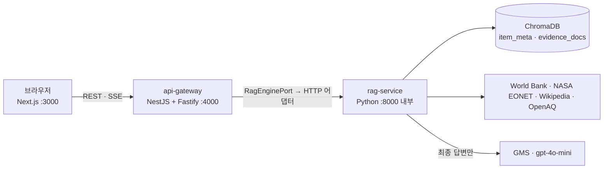

# 🏗️ 아키텍처

[README](../../README.md) · [기획서](../01-planning/PLAN.md) · [요구사항](../02-requirements/SRS.md) · [RAG 설계](./RAG_PIPELINE.md) · **아키텍처** · [데이터](../04-data/DATA_SOURCES.md)

## 1. 전체 흐름


| 계층 | 책임 | 하지 않는 것 |
|---|---|---|
| frontend | 화면·3D·상태·다국어 | 외부 API·LLM 직접 호출 |
| api-gateway | 세션·요청 제한·입력 검증·캐시·SSE 중계·오류 형식 | RAG 로직, 키 보관 |
| rag-service | 수집·색인·검색·생성, 환경 데이터 조회 | 공개 노출 (게이트웨이 뒤) |

**왜 이렇게?** 과제 필수 스택(Python·LangGraph·ChromaDB·Streamlit)은 RAG 엔진에 그대로 두고, 공개 API는 구조화가 쉬운 NestJS로 분리했다. 게이트웨이는 포트에만 의존하므로 엔진을 바꾸거나 가짜로 테스트하기 쉽다.

## 2. api-gateway — 헥사고날
```
presentation  modules/*/controller + DTO(class-validator)
presentation  modules/community/inbound/ (socket.io gateway · HTTP controller)
application   modules/*/service  (유스케이스: Earth · Lab · Community)
port          shared/ports/RagEnginePort · community/ports/(MessageStore · AttachmentStore · Identity · RoomEvents · MemoSummarizer)
adapter       shared/adapters/RagEngineHttpAdapter · community/adapters/(InMemory* · OriginPortIdentity · SocketIoRoomEvents · RagMemoSummarizer)
cross-cut     core/ SessionGuard · SessionThrottlerGuard · AppExceptionFilter · shared/cache/TtlCache
```

## 3. frontend — Feature-Sliced Design
```
app → widgets → features → entities → shared   (아래로만 import)
features: globe · cloud-lab · ask-cloud · compare · discovery · talk
entities: mascot · country · evidence · talk
shared:   ui(디자인 시스템) · lib(i18n·prefs·idle) · api
```
디자인 시스템은 별도 화면 없이 `globals.css` 토큰 + `shared/ui` 컴포넌트로만 쓴다.

## 4. 핵심 상호작용
- **지구본:** GeoJSON 국가 선택·카메라 이동·자동 회전(조작 시 정지)·SOS(PM2.5) 색 단계·EONET 마커. 대한민국은 제주도·울릉도·독도를 땅으로 그린다.
- **클라우드 빈:** 종이(정점 변형으로 구기기)·캔·페트병·종이컵을 드래그해 던지면 속도·중력·테두리 튕김·바닥 바운스를 계산한다. 입구를 통과하면 통이 통통 튀고, "분석하기" 후 뚜껑이 닫히며 구름이 생기고, 누르면 양옆으로 열린다.
- **캐릭터:** 사용자 제공 이미지(지구·구름 표정). 30초 동안 입력이 없으면 지구는 혼자 놀고 구름은 졸린다.

## 5. 토큰 예산 (70,000)
LLM은 최종 답변(P3)에만 · 임베딩은 내장 · 근거 600자 절단 · 출력 450토큰 · 같은 프롬프트 디스크 캐시 · 게이트웨이 결과 캐시 · 예산 소진 시 자동 오프라인.

## 6. 보안·세션
키는 `backend/.env.local`(git 무시)에만. 세션 ID는 브라우저 저장, 서버는 24시간 후 대화·업로드 삭제. 이미지는 저장하지 않는다.
