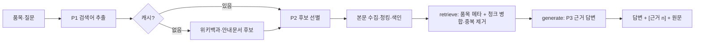

# 🧠 RAG 파이프라인 설계

[README](../../README.md) · [기획서](../01-planning/PLAN.md) · [요구사항](../02-requirements/SRS.md) · **RAG 설계** · [아키텍처](./ARCHITECTURE.md) · [데이터](../04-data/DATA_SOURCES.md)

## 1. 컬렉션 2개
| 컬렉션 | 단위 · ID | 메타데이터 |
|---|---|---|
| `item_meta` (RAG 1) | 품목 1건 = 텍스트 1건 · `item_id` | 이름(4개 언어)·별칭·분류·재질·배터리·유해성·배출 분류 |
| `evidence_docs` (RAG 2) | 청크 · `item_id:source_id:index` | 제목·URL·출처 유형·라이선스·수집일·content_hash |

같은 ID는 **upsert** → 재색인해도 중복 없음. 업로드 문서는 `session_id`로 격리.

## 2. 흐름

## 3. 프롬프트 3종 (`backend/cloudle/rag/prompts.py`)
| | 역할 | 출력 |
|---|---|---|
| **P1** | 품목·질문·지역·목적 → 검색어 (품목명 검색어 필수) | `{"queries": [...]}` |
| **P2** | 후보 제목·요약 중 관련 문서만 선택 (품목 직접 문서 보존) | `{"selected_ids": [...]}` |
| **P3** | 근거만 사용, 문장마다 `[근거 n]`, 없으면 "확인할 수 없음" | 섹션별 JSON |

## 4. 설정값 (`.env`로 변경)
`CHUNK_SIZE=1000` · `CHUNK_OVERLAP=200` · `TOP_K=5` · `USE_MMR=false` (F2014 비교용)

## 5. 원칙
- **RAG ≠ 통계 엔진:** 지구본 수치는 API에서 직접 조회(기준연도 표기), RAG는 지침·해설만.
- **근거 0건 → 추측 금지**, 외부 문서 속 지시문은 무시.
- **오프라인 모드:** 키가 없으면 P1·P2는 규칙 기반, P3는 근거 문장 발췌. 화면에 "오프라인 모드" 표시.
