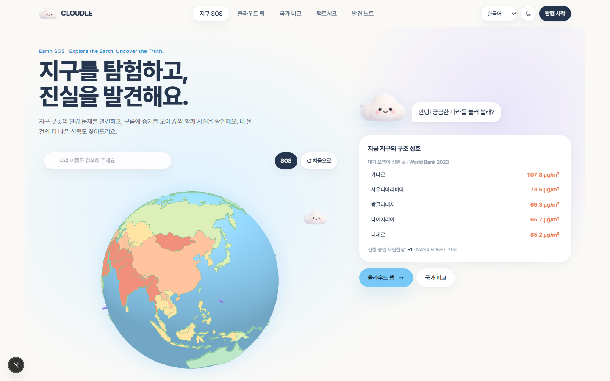
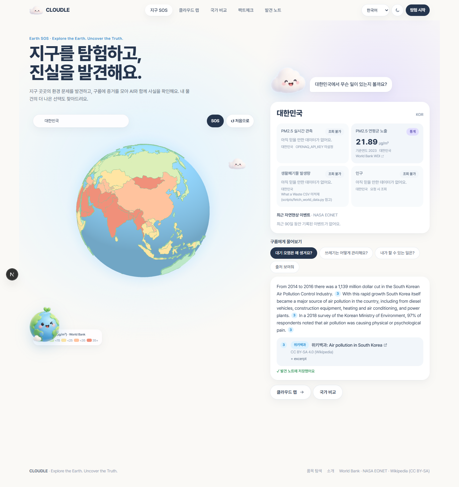
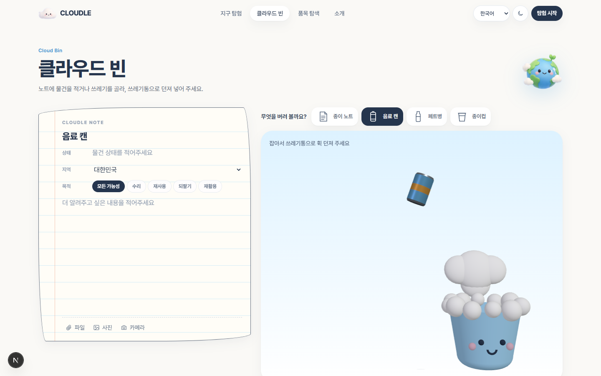
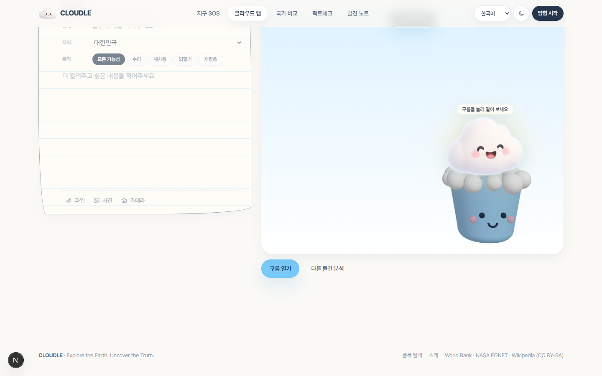
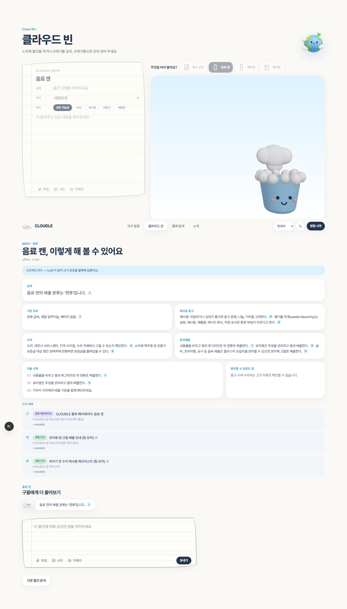
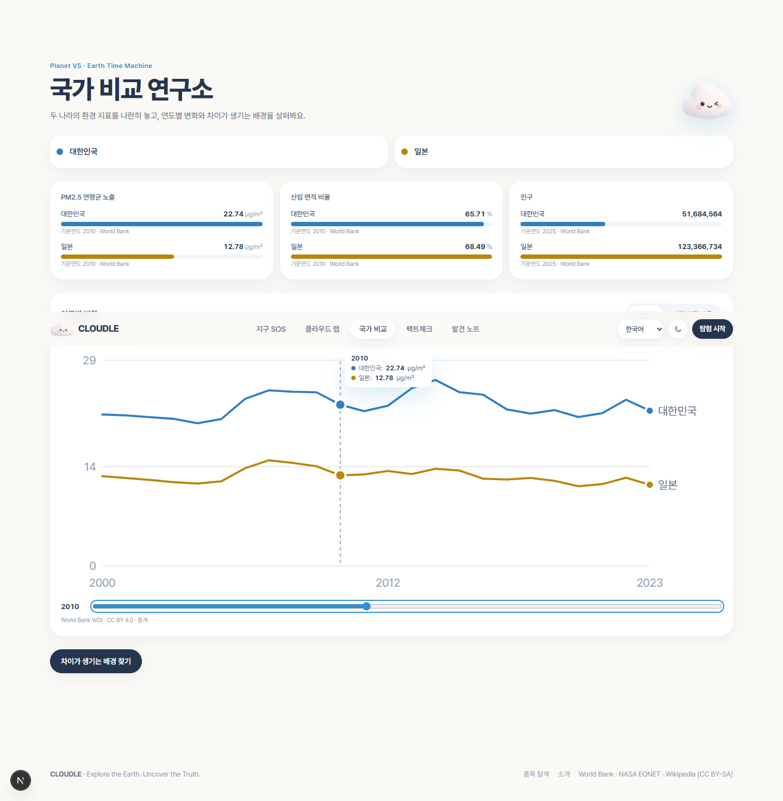
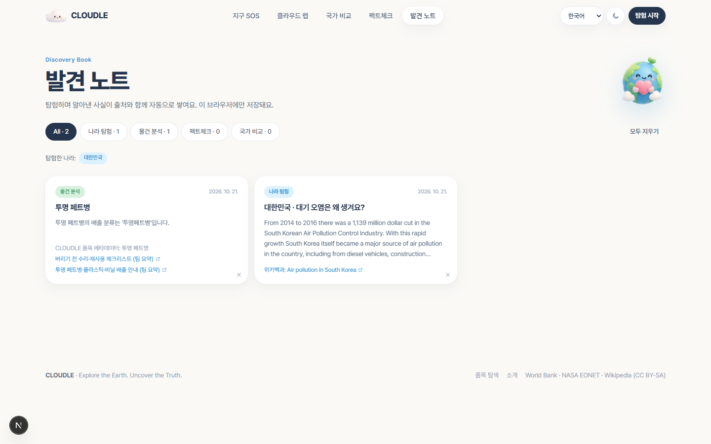
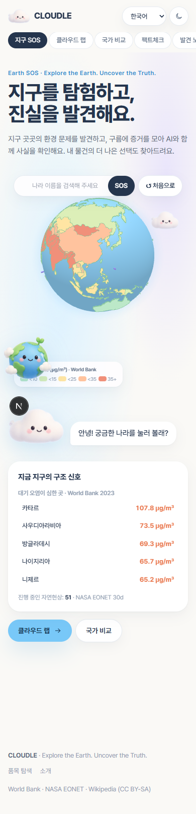

# ✅ 검증 결과

[README](../../README.md) · [요구사항](../02-requirements/SRS.md) · [구현 매핑](../02-requirements/TRACEABILITY.md) · **검증 결과** · [RAG 비교](./RAG_COMPARISON.md)

**검증일** 2026-10-21 · **환경** Windows 11, Python 3.12, Node 24 · **모드** 오프라인(LLM 키 없음)

## 1. 자동 테스트 (v2: 3개 서비스)
| 대상 | 명령 | 결과 |
|---|---|---|
| rag-service (RAG·API·Streamlit UI·토큰 예산) | `cd backend/rag-service && python -m pytest -q` | **44 passed** |
| api-gateway (세션·요청 제한·캐시·SSE·오류 형식) | `cd backend/api-gateway && pnpm test` | **6 passed** |
| frontend | `pnpm exec tsc --noEmit && pnpm lint && pnpm build` | 통과 (8개 화면) |

테스트는 가짜 위키백과·가짜 엔진 포트로 돌아가 **네트워크·API 키 없이** 재현된다.

## 2. 브라우저 시나리오 (Playwright 헤드리스, 3개 서비스 실제 기동)
| 시나리오 | 결과 |
|---|---|
| Earth SOS: 전 세계 PM2.5 레이어(World Bank 2023, 244개 국가·지역) · 오염 상위 국가 · 자연현상 51건 | ✅ |
| 나라 선택 → 핵심 지표만 조회 → "대기 오염은 왜?" → 위키백과 근거로 답 → 발견 노트 자동 저장 | ✅ |
| Cloud Lab: 캔을 **마우스 플릭으로 던짐**(포물선 비행 확인) · 페트병 "대신 던져 줘" → 분석 → 구름 열기 → 결과·채팅 | ✅ |
| Planet VS: 대한민국 vs 일본, 연도 슬라이더 2010 → 지표·차트 동기화 | ✅ (당시 결과 — Phase 8에서 기능 삭제) |
| Eco Detective: 주장 검토(오프라인이라 판정 보류 + 관련 문장) · 같은 주장은 캐시로 1초 이내 | ✅ |
| 모바일·다크 모드, 콘솔 오류 | ✅ 0건 |

## 3. 비기능 요구사항
| ID | 결과 | 근거 |
|---|---|---|
| NF2001 | ✅ 첫 분석 2.1–5.9s(수집 포함), 재분석 0.01s | [RAG 비교 §3](./RAG_COMPARISON.md) · LLM 사용 시 시간은 미측정 |
| NF2002 | ✅ 같은 검색어 재요청 시 외부 호출 0회 | `test_collect_indexes_with_metadata_and_caches` |
| NF2003 | ✅ 저장소에 키 없음 | `test_no_api_keys_in_repository` |
| NF2004 | ✅ 사용자에게 코드·메시지만 노출 | `test_analyze_errors_are_safe` |
| NF2005 | ✅ data / rag / sources / api / ui 분리 | [아키텍처](../03-design/ARCHITECTURE.md) |
| NF2006 | ✅ 호스트별 0.25s 간격, 429·5xx 재시도, User-Agent | `cloudle/sources/http.py` |
| NF2007 | ✅ 출처 대장 + 라이선스 표기 | [데이터 문서](../04-data/DATA_SOURCES.md) |

## 4. 화면
| | |
|---|---|
|  |  |
|  |  |
|  |  |
|  |  |

## 5. 미검증·제한 사항
- **LLM 경로 미실행:** `backend/.env.local`의 키가 비어 있어 GMS 실호출(최종 답변·팩트체크 판정)은 모의 응답 테스트만 했다. `GMS_KEY`를 넣으면 자동 전환된다.
- **오프라인 답변 품질:** 근거 문장 발췌 방식이라 문장이 매끄럽지 않고 한국어로만 나온다.
- **폐기물 통계:** World Bank 카탈로그 요청 제한으로 CSV 미적재 → "조회 불가" 표시.
- **OpenAQ 실시간 관측:** 키가 없어 미검증.
- **데이터 언어:** UI는 4개 언어, 품목 배출 정보는 한국어.
- **품목 배출 안내:** 팀 작성 초안이며 지자체 공식 지침 대조가 필요하다.
