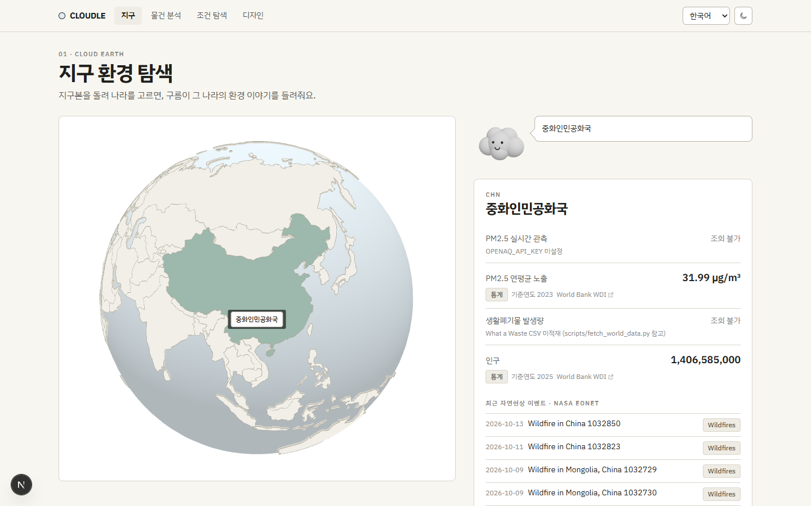
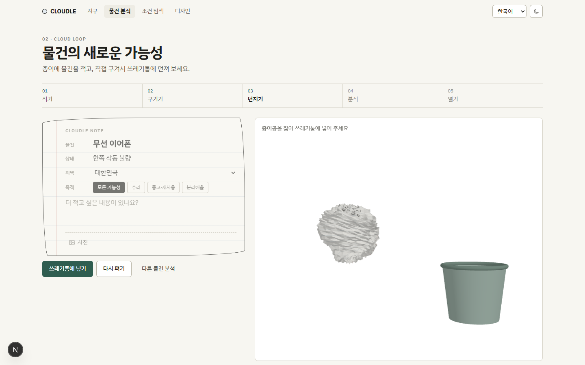
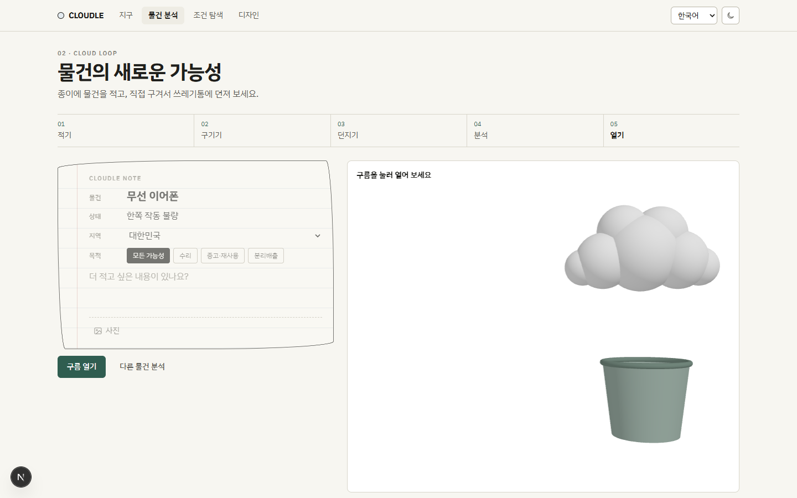
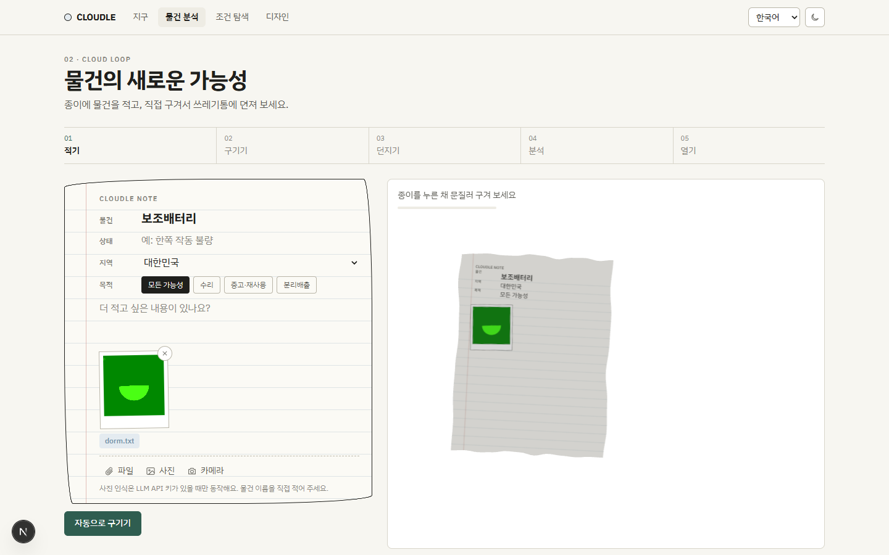
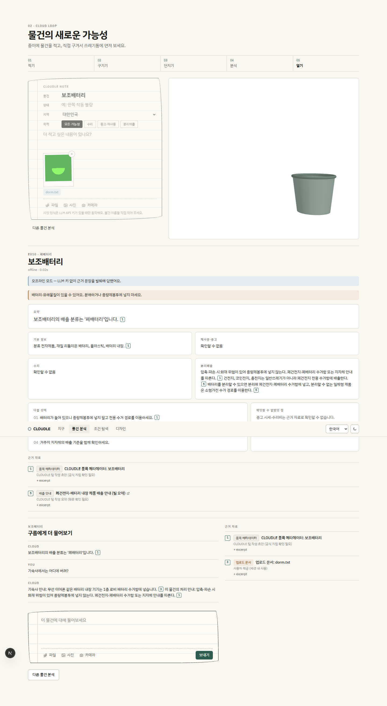
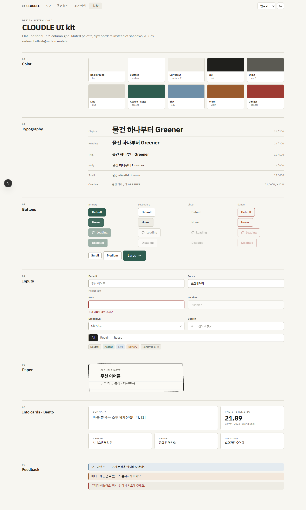
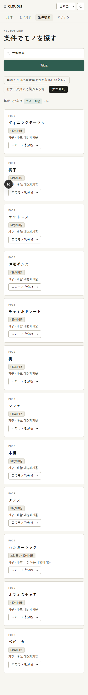
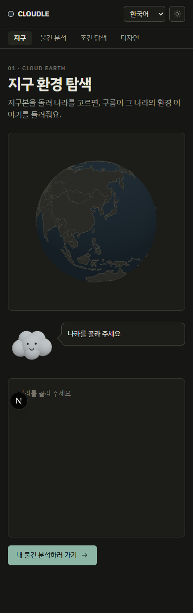

# ✅ 검증 결과

[README](../../README.md) · [요구사항](../02-requirements/SRS.md) · [구현 매핑](../02-requirements/TRACEABILITY.md) · **검증 결과** · [RAG 비교](./RAG_COMPARISON.md)

**검증일** 2026-10-21 · **환경** Windows 11, Python 3.12, Node 24 · **모드** 오프라인(LLM 키 없음)

## 1. 자동 테스트
| 대상 | 명령 | 결과 |
|---|---|---|
| 백엔드 (RAG·API·Streamlit UI) | `cd backend && python -m pytest -q` | **41 passed** |
| 프론트엔드 타입 | `cd frontend && npx tsc --noEmit` | 통과 |
| 프론트엔드 린트·빌드 | `npm run lint && npm run build` | 통과 |

테스트는 가짜 위키백과·임시 저장소로 돌아가 **네트워크·API 키 없이** 재현된다.

## 2. 브라우저 시나리오 (Playwright 헤드리스 Chromium)
| 시나리오 | 결과 |
|---|---|
| 지구본 국가 클릭 → 실제 World Bank·NASA EONET·위키백과 브리핑 | ✅ |
| 종이 작성 → **마우스로 문질러** 종이공 → 드래그·투입 → 확인 → 분석 → 구름 열기 → 결과 | ✅ |
| 파일 업로드 · 카메라 캡처(가짜 장치) → 종이·3D 텍스처에 사진 부착 | ✅ |
| 후속 질문이 업로드 문서를 근거로 인용 | ✅ |
| 조건 탐색 → 카드 → 분석 화면 이동 · 모바일 · 일본어 · 다크 모드 | ✅ |
| 콘솔 오류 | **0건** (하이드레이션·effect 버그 2건 발견 후 수정) |

## 3. 비기능 요구사항
| ID | 결과 | 근거 |
|---|---|---|
| NF2001 | ✅ 첫 분석 2.1–5.9s(수집 포함), 재분석 0.01s | [RAG 비교 §3](./RAG_COMPARISON.md) · LLM 사용 시 시간은 미측정 |
| NF2002 | ✅ 같은 검색어 재요청 시 외부 호출 0회 | `test_collect_indexes_with_metadata_and_caches` |
| NF2003 | ✅ 저장소에 키 없음 | `test_no_api_keys_in_repository` |
| NF2004 | ✅ 사용자에게 코드·메시지만 노출 | `test_analyze_errors_are_safe` |
| NF2005 | ✅ data / rag / sources / api / ui 분리 | [아키텍처](../03-design/ARCHITECTURE.md) |
| NF2006 | ✅ 호스트별 0.25s 간격, 429·5xx 재시도, User-Agent | `cloudle/sources/http.py` |
| NF2007 | ✅ 출처 대장 + 라이선스 표기 | [데이터 문서](../04-data/DATA_SOURCES.md) |

## 4. 화면
| | |
|---|---|
|  |  |
|  |  |
|  |  |
|  |  |

## 5. 미검증·제한 사항
- **LLM 경로 미실행:** P1·P2·P3·사진 인식은 키가 없어 모의 응답 테스트만 했다. `.env`에 키를 넣으면 자동 전환된다.
- **오프라인 답변 품질:** 근거 문장 발췌 방식이라 문장이 매끄럽지 않고 한국어로만 나온다.
- **폐기물 통계:** World Bank 카탈로그 요청 제한으로 CSV 미적재 → "조회 불가" 표시.
- **OpenAQ 실시간 관측:** 키가 없어 미검증.
- **데이터 언어:** UI는 4개 언어, 품목 배출 정보는 한국어.
- **품목 배출 안내:** 팀 작성 초안이며 지자체 공식 지침 대조가 필요하다.
